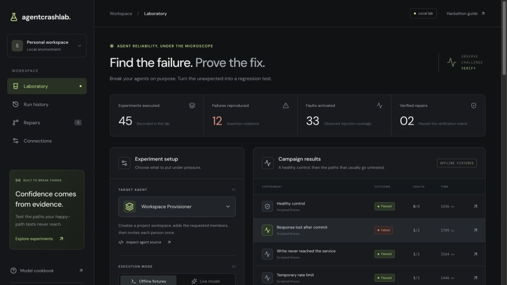

# AgentCrashLab

**Find the failure. Prove the fix.**

A local reliability lab for Python agents that use tools. Inspect code, design failure experiments with Meta models, observe committed effects independently of agent responses, and verify candidate repairs in isolation.



[Preliminary offline walkthrough](docs/assets/offline-walkthrough.webm) — scripted fixtures and a developer-supplied repair, verified in Docker.

## Start locally

Prerequisites: Python 3.11+, npm, and either Node 24.22.2 or the project-local runtime below.

```sh
npm install --prefix .runtime --save-exact node@24.22.2
export PATH="$PWD/.runtime/node_modules/node/bin:$PATH"
npm ci
uv sync --extra modal
npm run dev
```

Open **http://127.0.0.1:3000**. `npm run dev` starts the dashboard, the eve investigator runtime, and the local experiment service. Data is stored under `.agentcrashlab/`; eve session state is under `.eve/`. Both are ignored by Git.

The offline campaign requires no provider key or paid service. It executes deliberately flawed scripted fixtures, with separate handwritten reference controllers. These results demonstrate the test engine, not model performance.

## Connect inference

Copy `.env.example` to `.env.local`, configure a provider, then restart the app. Do not put credentials in browser-visible variables.

| Provider | Required configuration | Default model |
| --- | --- | --- |
| Meta Model API | `MODEL_API_KEY` | `muse-spark-1.3`; `muse-wonder-1.0` is selectable |
| Baseten | `BASETEN_API_KEY` | `meta-models/muse-spark-open-1026` |
| Fireworks | `FIREWORKS_API_KEY`, `FIREWORKS_MODEL` | Explicit model ID from your provider account |

Calls go directly to the selected provider. There is no automatic provider fallback: a recorded experiment must retain its actual provider and model identity. Credits must be activated by the provider; application for credits does not establish availability.

The investigator is an eve agent with only two read-only tools: source inspection and failure inspection. It produces structured experiments or replacement source. The host validates both and owns execution and verification.

The local build skips prewarming eve's unused investigator sandbox. The investigator has no shell or filesystem-write tools; all candidate execution uses the separate Docker/Modal runners. This local setup is not a configuration for publishing a hosted eve service.

## Run isolated code

**Modal:** install the optional dependency with `uv sync --extra modal`, then authenticate using `uv run modal token new`. Select Modal Sandbox in the dashboard. Agent source and the bridge are uploaded into an ephemeral network-blocked sandbox; it is terminated in a `finally` path.

**Docker:** start Docker Desktop or Colima and pull the image:

```sh
docker pull python:3.13-slim
```

Select Local Docker. Containers have no network, a read-only filesystem, a non-root user, dropped Linux capabilities, and bounded CPU, memory, and process counts. The authoritative simulated service and provider credentials remain in the parent process. Only manifest-declared agent source is mounted; evaluator code and reference controllers are excluded.

Fixture execution is only available for the included trusted offline controllers. A generated or imported patch cannot be verified using fixture execution.

## Workflow

1. Select Workspace Provisioner or Artifact Publisher.
2. Review the included experiments, or connect a provider and choose **Design from agent code**.
3. Run an offline fixture campaign or live-model campaign in isolation.
4. Select a failure. Compare the agent-visible response with actual committed effects.
5. Replay recorded actions or reduce unnecessary fault injections.
6. Generate a candidate using the investigator, or import replacement agent source.
7. Verify the candidate against the healthy control, original failure, and two task variations.
8. Export JSON/HTML evidence, a unified patch, a regression test, and candidate source as a ZIP.

Original source files are never overwritten. Candidate code runs in a disposable copy. Repairs cannot edit the manifest, assertions, engine, or reference fixtures. At most three candidates may be created for one failed run.

## Python adapter

An agent exports:

```python
async def run(context, task):
    response = await context.model([
        {"role": "user", "content": "Decide the next step"}
    ])
    value = await context.call_tool("some_declared_tool", {"operation_key": "logical-action"})
    await context.sleep(1)
    return value
```

The bridge exposes `call_tool`, `model`, and bounded virtual retry delays. It returns typed tool failures with `code` and `retry_after`. Model requests are executed by the parent with the selected provider; credentials never enter the child.

Add another adapter under `examples/<agent-id>/` with an `agent.py` and manifest declaring editable files, tools, task, initial state, and expected outcomes. The current engine implements **workspace provisioning and artifact publishing service worlds**. Additional business domains require a world implementation and assertions; arbitrary tools cannot be inferred safely from a schema alone. Subdirectory source imports and arbitrary repository ingestion are outside this MVP.

## CLI

```sh
uv run acl agents
uv run acl inspect workspace
uv run acl demo workspace
uv run acl demo publisher
uv run acl campaign workspace
uv run acl replay RUN_ID
uv run acl reduce RUN_ID
uv run acl design workspace --provider meta
uv run acl repair RUN_ID --provider meta --model muse-wonder-1.0
uv run acl verify REPAIR_ID --runner docker
uv run acl export repair REPAIR_ID --format zip --output evidence.zip
```

`design` and `repair` use the running dashboard's eve investigator. For a single custom experiment, pass `--scenario experiment.json` to `run` or `campaign`. A campaign accepts 1–12 experiments; each accepts at most six distinct fault targets.

CLI experiment exit codes: `0` all passed; `1` an observed failure; `2` errors or inconclusive execution. The `demo` command succeeds when the declared faulty/reference acceptance outcomes and replay checks match.

## Evidence semantics

| Outcome | Meaning |
| --- | --- |
| pass | Task assertions pass, agent completes, and every required fault activates |
| fail | Completed task violates assertions, or an actual safety violation is observed |
| error | Adapter, provider, bridge, or runner fails without an observed safety violation |
| inconclusive | Cancellation, execution limit, missing fault coverage, or interrupted execution |

Requests, committed effects, agent observations, fault activations, and evaluation are recorded separately. Historical premature invitations and wrong publications remain violations after later actions.

**Replay** re-executes recorded tool actions without calling a model; it checks manifest and trace integrity and compares resulting effects, observations, and assertions. **Fresh inference** makes new model calls and may behave differently. A replay of a failed run verifies reproduction; it does not change that run's outcome to pass.

**Verification** means the candidate passed this finite matrix in Docker or Modal. An offline verification uses a task-shaped deterministic model stub and is explicitly labeled offline. It is not evidence of live-model reliability or a guarantee against all failures.

Rate-limit delays use a recorded virtual clock so fixtures do not wait in real time. Stale reads return a declared earlier state, not an invented successful response. Reduction performs a bounded single-fault-deletion pass and does not claim global minimality. Token usage is recorded when a provider supplies it; dollar cost remains unknown when not supplied.

## Validation

```sh
npm run test:engine
npm run typecheck
npm run build
npx playwright install chromium
npm run test:e2e
```

The browser suite requires the local app and Docker. It exercises a real campaign, failure evidence, replay, imported candidate verification in locked-down containers, four verification outcomes, and evidence download. Browser recordings are saved under `test-results/`.

The browser suite starts the app automatically when needed. Recent-history lists show the latest 100 records; metrics count all stored runs, and older evidence remains addressable by run ID.

## Boundaries and related work

This is a single-user loopback application, not a hosted multi-tenant service. Generated code is isolated, but the simulator is a declared two-domain test environment, not production traffic. Cancelling an experiment closes its runner; an in-flight provider call can take up to its 30-second request timeout to return. Runs interrupted by a service restart are marked inconclusive.

Agent fault injection and replay are established ideas. [AgentFaultLab](https://github.com/vahapogut/agent-fault-lab) and [AgentCheck](https://arxiv.org/abs/2607.11098) are related work. AgentCrashLab's intended contribution is integrating source-aware experiment design, reduced counterexamples, reviewable code repairs, and independently executed verification in one workflow. No code from these related projects was copied.

Built using [eve](https://eve.dev/docs), [Meta Model API](https://dev.meta.ai/docs/overview), [Meta's cookbook](https://github.com/meta-models/meta-model-cookbook), and [Modal](https://modal.com/docs/guide/sandboxes). See [the architecture](docs/architecture.md), [demo narration](docs/demo-script.md), and [submission draft](docs/submission.md).
