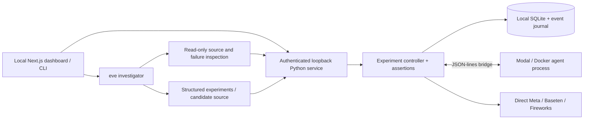

# Architecture and contracts

## Trust and ownership

- The engine owns service state, tool contracts, fault schedules, and assertions. The child receives its task and ordinary tool observations; the fault schedule and evaluator are not mounted.
- The parent executes model requests. The child receives model content, not credentials.
- Investigator source inspection is read-only. Optional eve default tools are disabled. Generated source must match the manifest allowlist and retain the adapter and model integration.
- Verification never writes a candidate into the original source tree. It checks original source and manifest hashes before creating a disposable copy.
- The Next.js proxy accepts loopback hosts and same-origin requests. The separate Python API requires a random server-only bearer token created at launch.

## Public interfaces

- Python: `async run(context, task) -> JSON-serializable result`; context provides `model(messages)`, `call_tool(name, arguments)`, and `sleep(seconds)`.
- Manifest: ID, domain, entrypoint, editable files, task, initial state, optional historical state, tool contracts, and expected outcomes. The domain selects engine-owned assertions.
- Experiment: name, description, faults, seed, and optional task variations. A fault specifies kind, tool, and call occurrence. The seed is recorded for provenance; current tool faults target explicit call occurrences rather than randomized scheduling.
- Events: sequence, elapsed time, kind, call ID, and typed payload. Committed effects include their resulting state snapshot.
- Repair: source replacements, unified diff, original source/manifest hashes, provenance, explanation, and verification run IDs.

## Local routes

`/api/lab/` proxies authenticated requests to the Python service:

| Method | Route | Purpose |
| --- | --- | --- |
| GET | bootstrap | Agents, safe provider configuration, history, jobs, repairs |
| GET | agents/:id | Manifest, source, starter experiments |
| GET | runs/:id | Complete recorded evidence |
| POST | campaigns | Start a bounded sequential campaign |
| POST | jobs/:id/cancel | Request cancellation |
| POST | runs/:id/replay | Verify recorded-action reproduction |
| POST | runs/:id/reduce | Start failure reduction |
| POST | repairs | Validate and save a candidate |
| POST | repairs/:id/verify | Start isolated verification |
| GET | export/:kind/:id?format=zip | Download evidence and source artifacts |

`POST /api/investigate` starts an authenticated eve session with an explicit provider/model and structured-output contract. Experiment proposals are reviewed before execution. Candidate creation is capped at three per failed run. The HTTP campaign service allows one execution/reduction/verification job at a time.

## Compatibility

Node 24.22.2, Python 3.11+, Next.js 16, React 19, eve 0.86.0. Dependency resolution is committed in package-lock.json and uv.lock. No Vercel account or hosted deployment is required for local use.
